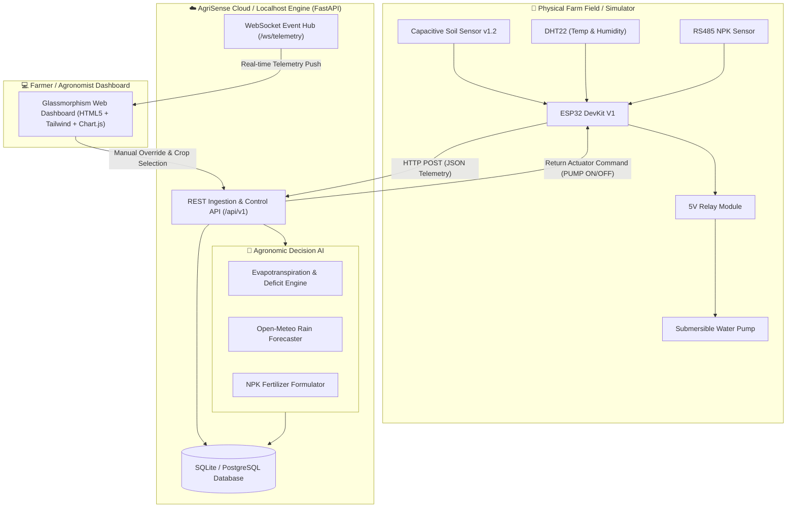

# 🌾 AgriSense: IoT + Cloud Smart Irrigation & Fertilization Advisor

[](https://fastapi.tiangolo.com)
[](https://www.python.org/)
[](https://www.docker.com/)
[](LICENSE)
[](.github/workflows/ci.yml)

> **AgriSense** is an end-to-end precision agriculture platform combining **IoT edge sensing (ESP32)**, **cloud-based agronomic intelligence**, and **automated actuation**. It dynamically calculates crop evapotranspiration ($ET_c$), detects soil moisture deficits, predicts rain deferrals, and computes exact commercial (Urea/DAP/MOP) and organic fertilizer dosages per acre.

---

## 📑 Table of Contents
- [Key Features](#-key-features)
- [System Architecture](#-system-architecture)
- [Project Directory Layout](#-project-directory-layout)
- [Quick Start: Run on Localhost](#-quick-start-run-on-localhost)
  - [Method 1: One-Click Launcher (Windows / Linux / Mac)](#method-1-one-click-launcher)
  - [Method 2: Manual Terminal Setup](#method-2-manual-terminal-setup)
  - [Method 3: Docker & Docker-Compose](#method-3-docker--docker-compose)
- [Virtual IoT Simulator (No Hardware Required!)](#-virtual-iot-simulator)
- [Deploy to GitHub & Cloud](#-deploy-to-github--cloud)
  - [Step 1: Push Project to GitHub](#step-1-push-project-to-github)
  - [Step 2: Free 1-Click Cloud Deployment (Render.com)](#step-2-free-1-click-cloud-deployment-rendercom)
  - [Step 3: Deploy to Railway / Heroku](#step-3-deploy-to-railway--heroku)
- [Hardware & ESP32 Firmware](#-hardware--esp32-firmware)
- [REST API Reference](#-rest-api-reference)
- [Agronomic Advisory Algorithms](#-agronomic-advisory-algorithms)

---

## 🌟 Key Features

### 1. Smart Irrigation Engine ($ET_c$ & Weather-Aware)
- **Soil Moisture Deficit Modeling**: Differentiates between **Optimal Field Capacity** and **Permanent Wilting Point** tailored to individual crops.
- **Evapotranspiration ($ET_c$)**: Integrates crop coefficient ($K_c$) with local temperature, solar radiation, and humidity ($ET_0$).
- **Smart Rain Deferral**: Automatically aborts or postpones irrigation if $>60\%$ precipitation probability is forecasted within 12 hours, saving valuable water and preventing nutrient leaching.
- **Automated Actuation**: Turns field submersible pumps and solenoid valves **ON/OFF automatically** or notifies farmers.

### 2. Smart NPK & Soil Fertilization Advisor
- **Macronutrient Diagnostics**: Real-time evaluation of Nitrogen ($N$), Phosphorus ($P$), and Potassium ($K$) levels against optimal crop baselines.
- **Commercial Formulation**: Converts soil deficits into exact quantities (in **kg** and **standard bags**) of:
  - **Urea** ($46\% \text{ N}$)
  - **DAP** ($18\% \text{ N}, 46\% \text{ P}_2\text{O}_5$)
  - **MOP** ($60\% \text{ K}_2\text{O}$)
- **Soil pH Analyzer**: Diagnoses Acidic vs Alkaline soil conditions, suggesting Agricultural Lime or Gypsum/FYM treatment.
- **Sustainable Organic Options**: Provides dosage for Farmyard Manure (FYM), Vermicompost, and Biofertilizers (*Azotobacter*, PSB, KMB).

### 3. Real-Time Interactive Glassmorphism Dashboard
- Single-port full-stack architecture (FastAPI serves both REST API, WebSockets, and UI).
- Real-time **WebSocket streaming** of sensor metrics.
- Live charts powered by **Chart.js**: Soil Moisture time-series with threshold zones, ambient temperature & humidity, and NPK radar balance.
- Built-in **Simulation Sandbox**: Inject dry soil, heatwaves, monsoons, or nutrient deficits with 1 click to test system reaction.

---

## 🏗 System Architecture



---

## 📂 Project Directory Layout

```
agrisense/
├── .github/
│   └── workflows/
│       └── ci.yml               # GitHub Actions CI automated testing pipeline
├── backend/
│   └── app/
│       ├── api/                 # REST API Routers
│       │   ├── telemetry.py     # Sensor ingestion & scenario simulation
│       │   ├── advisory.py      # Irrigation & Fertilizer advisory endpoints
│       │   ├── actuators.py     # Relay controls & auto/manual mode
│       │   └── crops.py         # Agronomic crop threshold profiles
│       ├── models/
│       │   ├── db_models.py     # SQLAlchemy ORM Database Models
│       │   └── schemas.py       # Pydantic validation schemas
│       ├── services/
│       │   ├── irrigation_advisor.py  # ETc & soil moisture logic
│       │   ├── fertilizer_advisor.py  # NPK dosage & organic suggestions
│       │   ├── weather_service.py     # Microclimate & rain probability
│       │   └── websocket_manager.py   # WebSocket broadcasting
│       ├── static/              # Dashboard Frontend
│       │   ├── css/custom.css   # Glassmorphic UI & animations
│       │   ├── js/app.js        # Charts, WebSocket, & interactive controls
│       │   └── index.html       # Single-Page AgriSense Dashboard
│       ├── config.py            # Environment configurations
│       ├── database.py          # Database connection
│       └── main.py              # FastAPI application entrypoint
├── firmware/
│   ├── agrisense_esp32.ino      # ESP32 Arduino C++ firmware sketch
│   └── WIRING_GUIDE.md          # Hardware pinout, schematics & calibration
├── simulator/
│   └── iot_device_sim.py        # Realistic virtual ESP32 sensor simulator
├── tests/
│   └── test_advisors.py         # Pytest test suite
├── .env.example                 # Example configuration file
├── .gitignore                   # Git ignore rules
├── Dockerfile                   # Docker container definition
├── docker-compose.yml           # Multi-container orchestration (App + Simulator)
├── Procfile                     # Railway / Heroku process declaration
├── render.yaml                  # 1-click Render.com cloud deployment blueprint
├── requirements.txt             # Python dependencies
├── run_local.bat                # Windows one-click launcher
├── run_local.sh                 # Linux / Mac launcher
└── README.md                    # Project documentation
```

---

## 🚀 Quick Start: Run on Localhost

### Method 1: One-Click Launcher

#### For Windows:
Double-click `run_local.bat` or run:
```cmd
.\run_local.bat
```

#### For Linux / macOS:
```bash
chmod +x run_local.sh
./run_local.sh
```
*The launcher automatically initializes a virtual environment, installs packages, and launches the server at `http://localhost:8000`.*

---

### Method 2: Manual Terminal Setup

1. **Clone or navigate into the project directory**:
   ```bash
   cd agrisense
   ```

2. **Create and activate a Python virtual environment**:
   ```bash
   # Windows
   python -m venv venv
   .\venv\Scripts\activate

   # Linux / macOS
   python3 -m venv venv
   source venv/bin/activate
   ```

3. **Install dependencies**:
   ```bash
   pip install -r requirements.txt
   ```

4. **Launch the FastAPI application**:
   ```bash
   uvicorn backend.app.main:app --host 0.0.0.0 --port 8000 --reload
   ```

5. **Open your browser**:
   - **Interactive Web Dashboard**: [http://localhost:8000](http://localhost:8000)
   - **Interactive Swagger API Docs**: [http://localhost:8000/docs](http://localhost:8000/docs)

---

### Method 3: Docker & Docker-Compose

Run the full system (Server + Virtual IoT Node Simulator) with one command:
```bash
docker-compose up --build
```
Access the dashboard at `http://localhost:8000`.

---

## 🤖 Virtual IoT Simulator

If you don't have physical ESP32 hardware right now, AgriSense includes an **interactive virtual node**:

1. Make sure the server is running on `http://localhost:8000`.
2. In a second terminal window, run:
   ```bash
   python simulator/iot_device_sim.py
   ```
3. Watch the console:
   - It streams realistic soil moisture, temperature, humidity, and NPK readings every 3.5 seconds.
   - When the backend switches the pump **ON**, soil moisture begins to rise.
   - When the pump is **OFF**, soil moisture gradually evaporates based on ambient heat!

---

## ☁️ Deploy to GitHub & Cloud

### Step 1: Push Project to GitHub

1. Open your terminal in the `agrisense` directory:
   ```bash
   git init
   git add .
   git commit -m "Initial commit: AgriSense IoT + Cloud Smart Advisor"
   ```

2. Create a new repository on [GitHub](https://github.com/new) named `agrisense`.

3. Link and push your code:
   ```bash
   git branch -M main
   git remote add origin https://github.com/<YOUR_USERNAME>/agrisense.git
   git push -u origin main
   ```

---

### Step 2: Free 1-Click Cloud Deployment (Render.com)

AgriSense includes a pre-configured `render.yaml` blueprint.

1. Sign up / log in to [Render.com](https://render.com).
2. Click **New +** -> **Blueprint**.
3. Connect your `agrisense` GitHub repository.
4. Render will read `render.yaml` automatically and configure:
   - **Build Command**: `pip install -r requirements.txt`
   - **Start Command**: `uvicorn backend.app.main:app --host 0.0.0.0 --port $PORT`
5. Click **Apply**. Within 2 minutes, your cloud AgriSense dashboard will be live with an HTTPS URL (e.g., `https://agrisense-xxxx.onrender.com`)!

---

### Step 3: Deploy to Railway / Heroku

Because the project includes a `Procfile`, `Dockerfile`, and `requirements.txt`:
1. **Railway.app**: Go to [Railway.app](https://railway.app), click **New Project** -> **Deploy from GitHub repo** -> select `agrisense`.
2. Railway will automatically detect the Python app and deploy it on a public domain.

---

## 🔌 Hardware & ESP32 Firmware

To connect physical sensors:
1. Open `firmware/agrisense_esp32.ino` in the [Arduino IDE](https://www.arduino.cc/en/software).
2. Install the **ESP32 Board Package** and libraries:
   - `ArduinoJson` (by Benoit Blanchon)
   - `DHT sensor library` (by Adafruit)
3. Set your WiFi credentials in the code:
   ```cpp
   const char* WIFI_SSID     = "YOUR_WIFI_NAME";
   const char* WIFI_PASSWORD = "YOUR_WIFI_PASSWORD";
   ```
4. Set your Server endpoint:
   ```cpp
   // For local testing on the same WiFi network (replace with your computer's local IPv4)
   const char* SERVER_ENDPOINT = "http://192.168.1.100:8000/api/v1/telemetry";

   // For cloud deployment (Render/Railway)
   // const char* SERVER_ENDPOINT = "https://your-agrisense-app.onrender.com/api/v1/telemetry";
   ```
5. Flash the code to your ESP32. Check [firmware/WIRING_GUIDE.md](firmware/WIRING_GUIDE.md) for full circuit schematics and pin tables.

---

## 📡 REST API Reference

| Method | Endpoint | Description |
| :--- | :--- | :--- |
| `POST` | `/api/v1/telemetry` | Ingest sensor data from ESP32 / Simulator; returns pump command |
| `GET` | `/api/v1/telemetry/latest` | Retrieve latest telemetry snapshot |
| `GET` | `/api/v1/telemetry/history` | Chronological telemetry series for Chart.js graphing |
| `POST` | `/api/v1/telemetry/simulate` | Inject test scenarios (`HEATWAVE`, `HEAVY_RAIN`, `SOIL_DROUGHT`, etc.) |
| `GET` | `/api/v1/advisory/irrigation` | Get $ET_c$-based irrigation recommendation & liters needed |
| `GET` | `/api/v1/advisory/fertilizer` | Get NPK diagnostic & Urea/DAP/MOP commercial bag calculation |
| `GET` | `/api/v1/advisory/summary` | Combined snapshot for frontend dashboard |
| `GET` | `/api/v1/actuators/status` | Current pump, valve, crop, and auto/manual mode state |
| `POST` | `/api/v1/actuators/control` | Toggle pump, valve, auto-mode, or change active crop |
| `GET` | `/api/v1/crops` | List supported crops and their moisture/NPK thresholds |
| `GET` | `/health` | Container & cloud service health check |

---

## 🧠 Agronomic Advisory Algorithms

### 1. Evapotranspiration ($ET_c$) Formula
$$ET_c = ET_0 \times K_c$$
Where:
- $ET_0$ = Reference Evapotranspiration (computed via Hargreaves-Samani method using ambient temperature, diurnal temperature range, and extraterrestrial radiation).
- $K_c$ = Crop Coefficient (e.g., $1.05$ for Wheat, $1.25$ for Rice, $0.85$ for Cotton, $1.15$ for Tomato).

### 2. Water Deficit Calculation
$$\text{Deficit (mm)} = (\text{Field Capacity} - \text{Current Moisture}) \times \text{Root Zone Depth Factor}$$
$$\text{Water Volume (Liters)} = \text{Deficit (mm)} \times 4046.86 \times \text{Field Area (Acres)}$$

### 3. Fertilizer Formulation Logic
$$\text{DAP Required (kg)} = \frac{P_{\text{deficit}}}{0.46}$$
$$\text{Nitrogen supplied by DAP} = \text{DAP} \times 0.18$$
$$\text{Urea Required (kg)} = \frac{\max(0, N_{\text{deficit}} - N_{\text{DAP}})}{0.46}$$
$$\text{MOP Required (kg)} = \frac{K_{\text{deficit}}}{0.60}$$

---

## 🧪 Running Automated Tests

Run the test suite using `pytest`:
```bash
pytest -v tests/
```

---

## 📄 License
This project is open-source and licensed under the [MIT License](LICENSE).
